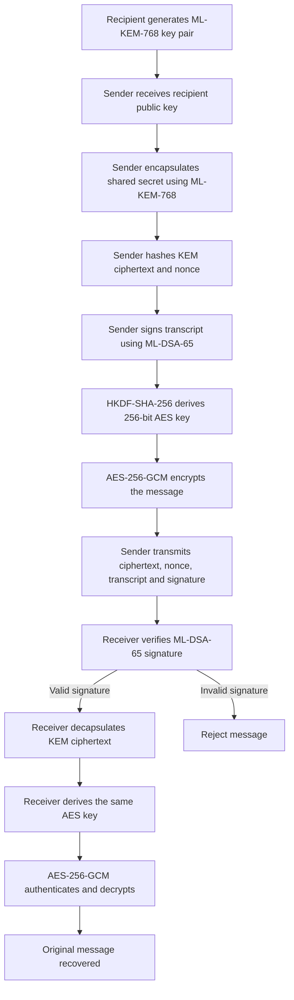
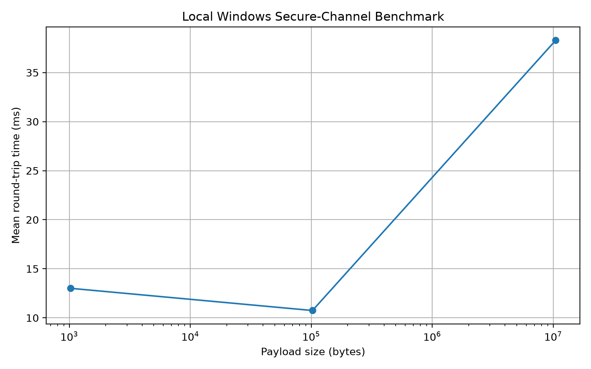
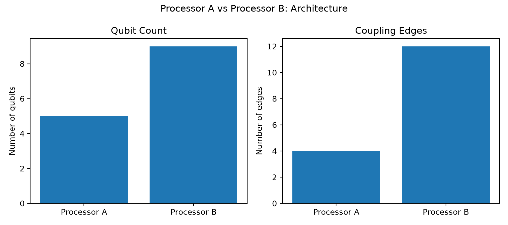
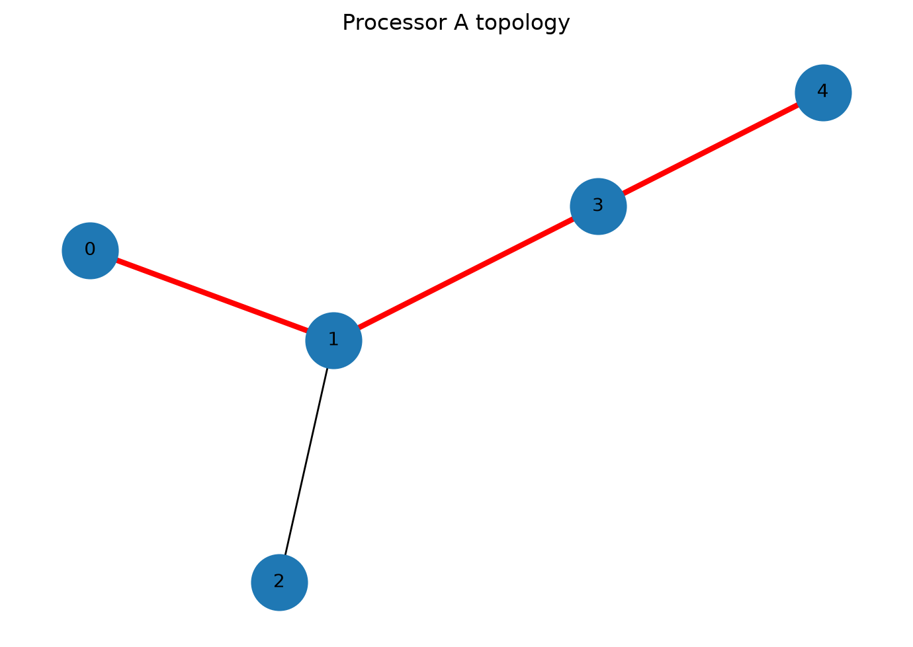
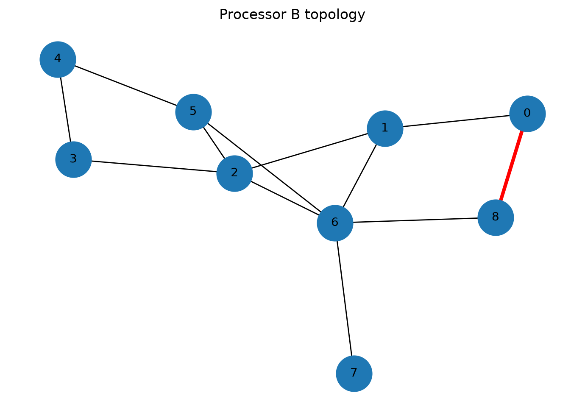

# P1 — Quantum-Safe Secure Channel

## 1. Objective
Implement the official P1 problem statement and evaluate it using the supplied Processor A and Processor B models.

## 2. Methodology
The secure channel uses ML-KEM-768 for key establishment, ML-DSA-65 for sender authentication, HKDF-SHA-256 for key derivation, and AES-256-GCM for authenticated encryption. Processor topology and shortest-path routing are also analyzed.

## 3. Experimental Setup
- Processor A: official configuration to be added
- Processor B: official configuration to be added

## 4. Results
Local Windows benchmarks were run for 1 KB, 100 KB, and 10 MB payloads. The results are documented below; cryptographic performance on Processor A and Processor B was not measured.
## 5. Processor A vs Processor B
Processor A has 5 qubits and 4 coupling edges; Processor B has 9 qubits and 12 coupling edges. Shortest paths were calculated from their supplied coupling maps. This is a topology comparison, not a hardware performance benchmark.
## 6. Limitations
Document assumptions, constraints, and unavailable resources.

## 7. Conclusion
The local secure-channel tests and TCP demonstration passed. The project also includes processor topology visualizations and shortest-path routing. Results are limited to the tested local implementation; Processor A/B cryptographic performance remains unmeasured.

## Secure Channel Protocol Flow

## Local Software Benchmark Results

The secure-channel prototype was evaluated on the local Windows computer using ML-KEM-768, ML-DSA-65, HKDF-SHA-256, and AES-256-GCM. Each payload size was tested over five rounds.

| Payload size | Mean round-trip time (ms) | Median round-trip time (ms) | Peak traced Python memory (bytes) | Packet bytes | Correctness |
|---|---:|---:|---:|---:|---|

| 1 KB (1,024 B) | 13.009 | 14.044 | 14,529 | 5,481 | Passed |
| 100 KB (102,400 B) | 10.747 | 9.562 | 313,427 | 106,857 | Passed |
| 10 MB (10,485,760 B) | 38.286 | 38.441 | 31,463,507 | 10,490,217 | Passed |

### Measurement Notes

- Round-trip time measures the local encryption and decryption operation, including signature creation and verification. It is not a network handshake latency measurement.
- Peak memory is measured using Python's `tracemalloc`; it does not represent total process memory.
- Packet bytes include the KEM ciphertext, nonce, transcript, signature, and encrypted message. They exclude public-key distribution, network framing, and transport overhead.
- Results were obtained on a single local Windows computer and are reported as the custom Platform D software benchmark. They are not measurements from Processor A or Processor B. Platform A and B cryptographic performance remains unmeasured.
- Each payload size was tested five times. Results may vary with system load and software environment.
**Packet-byte measurement:** The reported packet size is calculated by summing the lengths of all byte-valued fields returned by the local message-creation function. It includes the KEM ciphertext, nonce, transcript, signature, and encrypted message. It excludes public-key distribution, network headers, and other transport overhead; therefore, it is not a measurement of total network bytes exchanged.

### Results Analysis

The local benchmark completed successfully for all three payload sizes, and the correctness check passed in every case. The mean round-trip time was 13.009 ms for the 1 KB payload, 10.747 ms for the 100 KB payload, and 38.286 ms for the 10 MB payload.

The 1 KB and 100 KB measurements were similar in this five-round run, while the 10 MB payload took longer and required substantially more traced Python memory. Peak traced Python memory increased from 25,910 bytes for 1 KB to 31,463,507 bytes for 10 MB. This is consistent with the larger payload and associated processing allocations, but these measurements alone do not isolate the cost of each cryptographic operation.

The packet-byte count includes the byte fields returned by the local prototype. It does not include public-key distribution, transport framing, or other network overhead. These results therefore describe a local cryptographic round trip, not a complete network handshake or a comparison across quantum processors.

Because each payload size was tested for only five rounds on one Windows computer, the measurements should be treated as preliminary. Repeated runs across clearly specified platforms are needed for a stronger performance comparison.

### Benchmark Visualizations

### Benchmark Visualizations

**Local secure-channel benchmark**

**Processor architecture comparison**

**Processor A topology with shortest path**

**Processor B topology with shortest path**

### Source Code Size

The Python source files under `src/` contained 10,296 characters, measured using PowerShell by recursively reading `.py` files and counting characters. This measurement is a source-size proxy; it does not represent compiled binary size, installed library size, or the size of the complete repository.

### Sender-Side Cryptographic Operation Benchmark

A separate 20-round benchmark measured sender-side ML-KEM-768 encapsulation and ML-DSA-65 signing on the local Windows computer. The mean time was 7.849 ms, the median time was 6.172 ms, and peak traced Python memory was 19,019 bytes.

This measurement excludes receiver-side signature verification, KEM decapsulation, key derivation, payload encryption, and network communication. It is therefore a partial cryptographic-operation benchmark, not a complete handshake measurement. It should not be compared directly with the payload round-trip timings above.

## Man-in-the-Middle Risk and Mitigation

### Threat

An attacker positioned between two communicating peers could intercept or replace messages. In a key-exchange protocol, an attacker may attempt to substitute their own public key so that each peer establishes a secret with the attacker instead of with the intended recipient.

### Mitigation with ML-DSA

ML-DSA-65 is used to digitally sign the protocol transcript. The receiver verifies the signature using the sender's trusted public verification key before accepting the message. This helps detect unauthorized transcript modification and sender impersonation.

### Trust Assumption and Limitations

Digital signatures do not automatically prevent every man-in-the-middle attack. The receiver must obtain the sender's public verification key through a trusted process, such as a verified certificate or an authenticated out-of-band exchange. If an attacker can replace the trusted public key itself, signature verification may not establish the intended identity.

The current prototype demonstrates signature verification and rejection of a modified encrypted message and an altered signature in local tests. It does not yet demonstrate a full network exchange between independent peers. Network-level MITM resistance and authenticated public-key distribution remain future validation tasks.  

### Security Test Results

The local prototype passed four checks: successful message recovery, rejection of modified ciphertext, rejection of an altered ML-DSA signature, and rejection when the receiver is given an incorrect expected recipient public key. These tests demonstrate the tested behaviours of the implementation; they do not establish complete protection against network-level man-in-the-middle attacks. Secure distribution and verification of public keys, peer identity binding, and network interoperability require further validation.

## Processor Topology Comparison

The supplied processor configurations were analyzed using their qubit counts and coupling maps.

| Metric | Processor A | Processor B |
|---|---:|---:|
| Qubit count | 5 | 9 |
| Coupling connections | 4 | 12 |
| Connection density | 0.4000 | 0.3333 |
| Average degree | 1.600 | 2.667 |
| Basis gates specified | Yes | Yes |
| Noise model specified | Yes | Yes |

Processor B has more qubits, three times as many listed connections, and a higher average degree. Processor A has a higher connection density relative to the number of possible qubit pairs.

**Limitations:** Both processor configurations now specify the required basis gates and identical synthetic noise rates. Noisy circuit simulations and transpilation tests have been conducted using the configured reference models. These remain simulated results, not measurements from physical quantum hardware.
The local Windows software benchmarks are reported separately and must not be interpreted as Processor A or Processor B hardware results.

## Processor Routing and Topology Analysis

The processor configurations were loaded from the supplied JSON files. A breadth-first search was used to calculate shortest paths over the documented coupling maps.

| Metric | Processor A | Processor B |
|---|---:|---:|
| Qubits | 5 | 9 |
| Coupling edges | 4 | 12 |
| Tested route | 0 → 1 → 3 → 4 | 0 → 8 |
| Shortest-path hops | 3 | 1 |
| Intermediate qubits | 2 | 0 |

### Visualizations

These results describe connectivity and shortest-path routing on the supplied topology graphs. They do not represent measured quantum execution time, gate fidelity, noise, or cryptographic performance on either processor.

## Processor Topology and Noisy Simulation Results

### Experimental setup

Processor A was configured with 5 physical qubits and 4 coupling edges. Processor B was configured with 9 physical qubits and 12 coupling edges. Both configurations used the basis gates `rz`, `sx`, `x`, and `cx`, with identical synthetic noise parameters: single-qubit depolarizing probability 0.001, two-qubit CX depolarizing probability 0.005, and readout error probability 0.01.

Transpilation used optimization level 1 and seed 42. The noisy simulations used 4,096 shots per processor.

### Connectivity-sensitive circuit results

| Metric | Processor A | Processor B |
|---|---:|---:|
| Transpiled circuit depth | 28 | 7 |
| `rz` gates | 34 | 10 |
| `sx` gates | 17 | 5 |
| `cx` gates | 11 | 5 |
| SWAP gates | 0 | 0 |
| Simulation shots | 4,096 | 4,096 |

### Discussion

For the tested five-qubit interaction circuit, Processor B produced a transpiled circuit depth of 7 compared with 28 for Processor A, a 75% reduction. Processor B also required fewer `rz`, `sx`, and `cx` gates. Neither transpiled circuit contained SWAP gates.

These results suggest that the supplied Processor B connectivity better accommodates this particular circuit under the selected transpilation settings. They do not establish universal superiority: the comparison uses one circuit and simulated processor configurations, not measurements from physical quantum hardware.

The measurement counts were generated by a stochastic noisy simulator. Further evaluation against an ideal reference distribution and additional circuits would be needed to quantify output quality and determine whether the observed structural advantage generalizes.

### Limitations

The experiment uses synthetic noise parameters and a single test circuit. It does not measure physical hardware performance, and circuit depth is not equivalent to execution time. The results should therefore be interpreted as a topology and simulation comparison rather than a hardware speed benchmark.